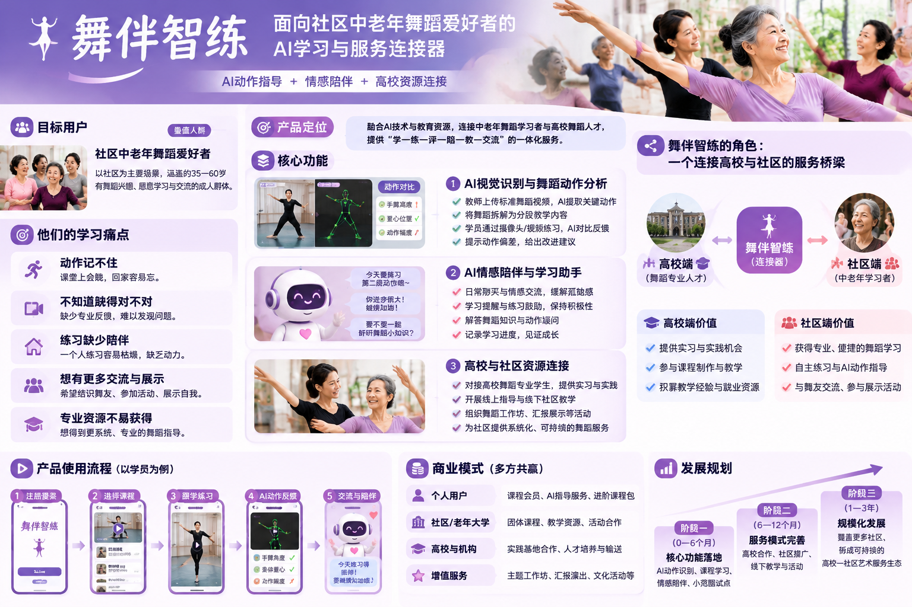

# 舞伴智练｜V2.2 产品介绍与当前代码对照

## 1. 产品定位（按产品介绍稿）

舞伴智练以现代舞学习为切入点，面向社区中老年舞蹈爱好者。产品将 AI 视觉识别、动作拆解、视频对照和 AI 情感陪伴融入学习过程，同时规划连接高校舞蹈专业学生、教师与社区教学资源，帮助专业教学服务走进社区。

核心逻辑：AI 帮助看懂动作；教师负责专业审核；AI 陪伴帮助保持兴趣和练习动力；高校舞蹈人才提供后续教学、课程制作与社区实践服务。

产品概念图（由项目方提供，属于产品构想，不代表当前真实界面或功能已经上线）：

## 2. 三大核心支柱：当前实现程度

### A. AI 动作指导

**当前已有：**
- `miniprogram-full/server/vision/pose_service.py` 使用 MediaPipe Pose Landmarker 对短视频抽样提取 33 个人体姿态关键点。
- 输出时间戳、关键点 JSON、骨架预览视频、姿态关键帧联系表。
- 教师可以在集成网页中手动选取片段起止时间，填写动作名称和教学说明，标记教师确认并发布课程。
- 学员可以选择已发布课程和已审核片段，上传自己的练习视频，系统提取姿态并提供并排视频/骨架预览。

**还没有：**
- 自动识别舞蹈动作名称、编舞语义和艺术表达。
- 稳定的自动动作边界/动作段落推荐。当前教师需要手动选起止时间；AI输出的是姿态采样和可视化线索。
- 标准与学员视频的可靠自动时间轴对齐。
- 经专业验证的动作质量评分、百分制评分或自动纠错口令。
- 实时摄像头动作纠错。

**演示时正确说法：**“系统先提取人体关键点和关键帧，教师结合示范视频手动切分、填写讲解并审核，学员再上传练习视频进行辅助观察。”不要说“AI已经自动拆解并判断舞蹈动作标准”。

### B. AI 情感陪伴

**当前已有：**
- 轻量网页 `webapp/companion.js` 内置舞蹈学习话题、情绪回应和安全边界规则。
- 集成网页的 `/api/chat` 支持本地知识答复；设置服务端模型环境变量后，可选接入兼容接口。
- 对动作标准、医疗建议、评分等问题设有边界提示。

**还没有：**
- 默认已接入在线大模型（默认未配置密钥）。
- 基于个人长期学习档案的个性化复习计划。
- 主动问候、定时提醒、兴趣挑战、打卡分享的完整产品工作流。
- 用户可管理的长期陪伴偏好和多设备同步。

**演示时正确说法：**“当前是基础陪伴原型。轻量网页使用本地规则/知识库；集成网页可选配置在线模型。后续再根据真实用户反馈增强个性化。”

### C. 高校—社区资源连接

**当前状态：尚未开发。**

产品介绍中的高校人才报名、身份/能力审核、社区需求发布、线上指导/社区兼职教学、课程制作、服务评价和结算，目前只有产品规划，没有对应可运行模块、真实合作协议或真实岗位数据。

**建议顺序：**先完成第一阶段用户验证；再访谈社区、老年大学和高校舞蹈专业学生；找到明确需求和合作方后，先用人工匹配/小范围试点验证，不要先投入复杂的人才平台开发。

## 3. 五大功能模块逐项对照

| 产品介绍中的模块 | 当前可运行内容 | 当前状态 | 下一步建议 |
|---|---|---|---|
| 01 AI 视觉识别与动作拆解 | 视频姿态抽样、关键点、时间戳、骨架预览、关键帧联系表；教师手动分段和审核 | 部分实现 | 优化识别稳定性、教师片段编辑体验；再研究候选动作变化点辅助提示 |
| 02 舞蹈动作精讲与知识学习 | 动作精讲、记忆陪练、衔接训练、现代舞知识、艺术表达；教师手工录入讲解 | 基础原型 | 以教师审核后的真实课程内容替换示例内容；为每段建立清晰讲解卡 |
| 03 学员视频对照与 AI 智能陪练 | 学员上传练习视频、姿态提取、视频并排、骨架联系表 | 部分实现 | 先验证学员是否看懂；再逐步做动作片段对齐和可解释反馈 |
| 04 AI 情感陪伴与兴趣互动 | 本地知识库/规则问答；可选在线模型配置 | 基础原型 | 增强多轮理解、学习上下文和复习建议；先测回答有用性，不急于做主动推送 |
| 05 青年舞蹈人才服务 | 当前无对应功能 | 尚未开发 | 第二阶段调研服务供需，先人工匹配试点，再决定是否产品化 |

## 4. 项目包中三套程序的关系

### 4.1 集成网页原型（推荐主演示）

路径：`miniprogram-full/server/`

这是最贴近产品介绍中“教师—学员学习闭环”的版本。其网页 `index.html` 含学习首页、动作精讲、记忆陪练、舞蹈知识、AI 舞伴、艺术表达、教师工作区和 AI 视频识别页面；FastAPI 后端提供课程、片段审核发布、视频姿态分析、练习上传、对照和聊天接口。

数据保存在运行服务的本机 SQLite 和本机文件夹。它不是云端 SaaS，也没有正式多用户身份权限。

### 4.2 轻量网页原型

路径：`webapp/`

只有四项主要演示功能：老师示范、我的练习、动作对照、AI 陪伴。视频和姿态识别在浏览器本地运行；没有教师审核发布工作流、账号、云端数据库和后台用户分析。

### 4.3 微信小程序实验版

路径：`miniprogram-full/miniprogram/`

有首页、课程、课程详情、练习、对照、聊天、记录、我的等页面，需连接 FastAPI 后端并使用微信开发者工具调试。当前未正式提交审核上线。

## 5. 数据与隐私的真实状态

- 轻量网页：不上传用户视频到项目后端；当前会话中的视频和聊天状态不会自动形成长期云端档案。
- 集成网页：课程、视频、姿态结果和任务数据存放在运行服务的本机；服务所在电脑承担数据保管责任。
- 小程序实验版：通过本机后端访问；不是生产级多租户隔离。
- 当前没有统一的用户账号、权限管理、自动化产品分析仪表盘或云端用户档案。
- 真实用户试用阶段建议用匿名编号，手工记录完成情况和反馈；视频、照片需单独取得明确同意。

## 6. 分阶段开发建议

### 第一阶段：核心学习闭环验证（当前）

目标不是把 V2.2 所有功能一次做完，而是验证社区中老年舞蹈爱好者是否真的愿意用、能不能用、是否有帮助。

- 教师端：一门课程、1 段示范视频、3—5 个教师手动确认的动作片段。
- 学员端：3—5 名真实用户完成课程选择、练习视频上传和动作对照。
- 陪伴端：测试常见练舞问题、连续追问和答非所问情况。
- 记录：独立完成率、求助次数、任务耗时、满意度、用户原话、改进前后复测。

### 第二阶段：体验增强与社区拓展

- 根据测试优化适老化界面、视频流程、动作说明和陪伴回答。
- 建立学习记录/复习机制的最小版本。
- 访谈社区、老年大学、高校舞蹈专业学生，验证教学服务供需。
- 选择一个社区或课程做人工撮合的线上指导/线下教学小试点。

### 第三阶段：服务网络与运营

在有真实合作方和需求后，再评估人才认证、需求发布、服务评价、课时管理、费用结算、社群和活动功能。

### 第四阶段：文化体验拓展

艺术体验、主题活动等可在服务体系成熟后再考虑；旅行相关业务应与有资质的专业机构合作。

## 7. 现场展示时的统一表述

> “舞伴智练的完整产品方向是三大支柱、五大模块。当前交付的是第一阶段原型：已经有基础视频姿态识别、教师手动分段审核、学员视频对照、动作学习内容和基础 AI 陪伴。高校—社区人才服务、自动动作语义理解、完整学习档案和规模化运营还在规划中。我们先通过 3—5 名真实用户验证核心学习闭环，再根据数据决定下一步开发。”
